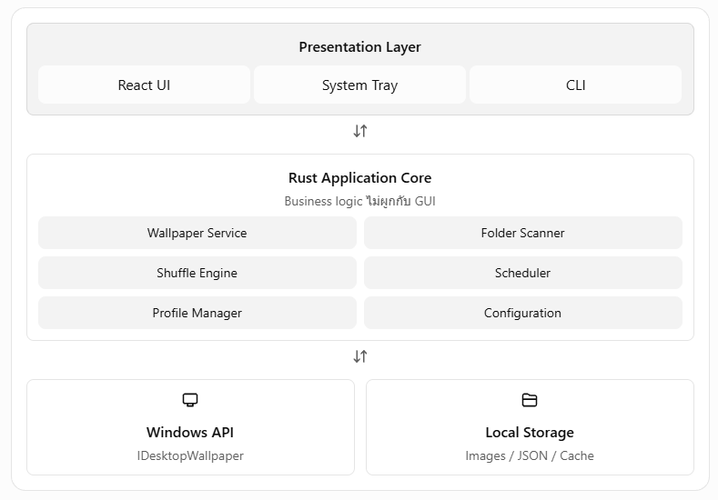
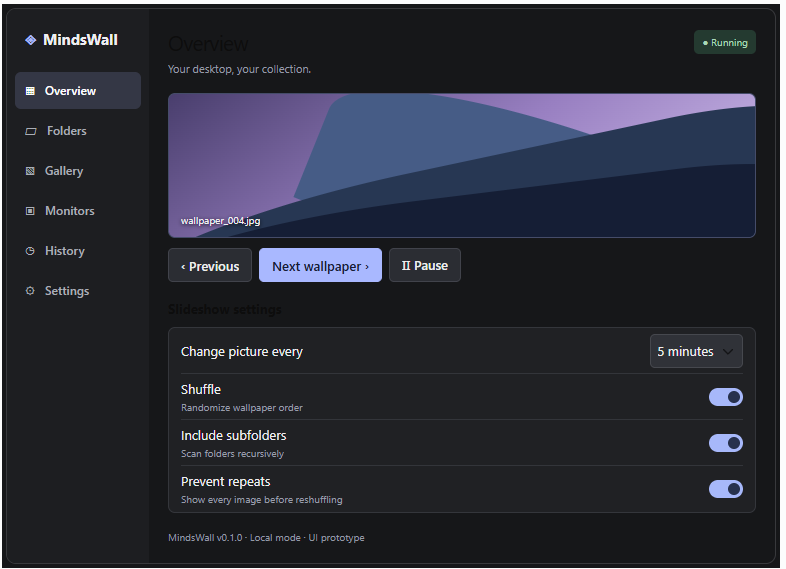
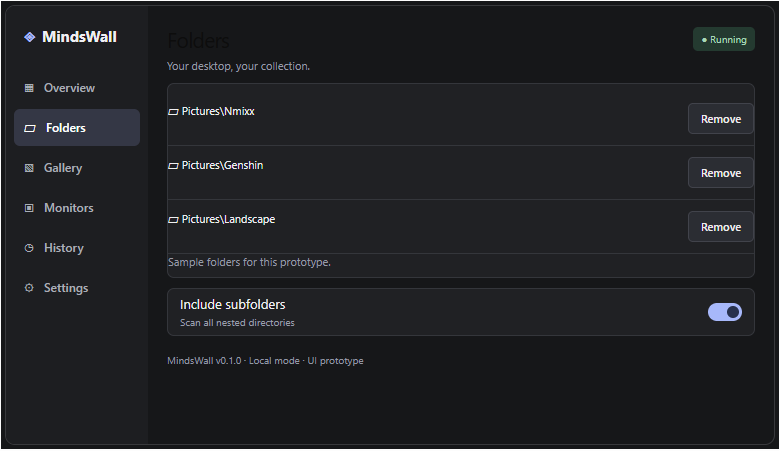
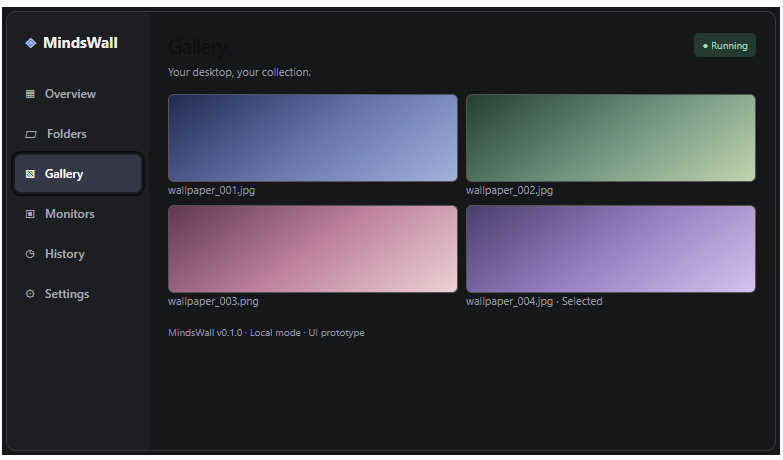
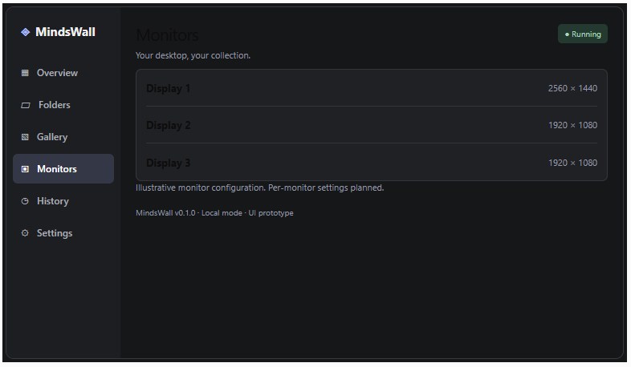
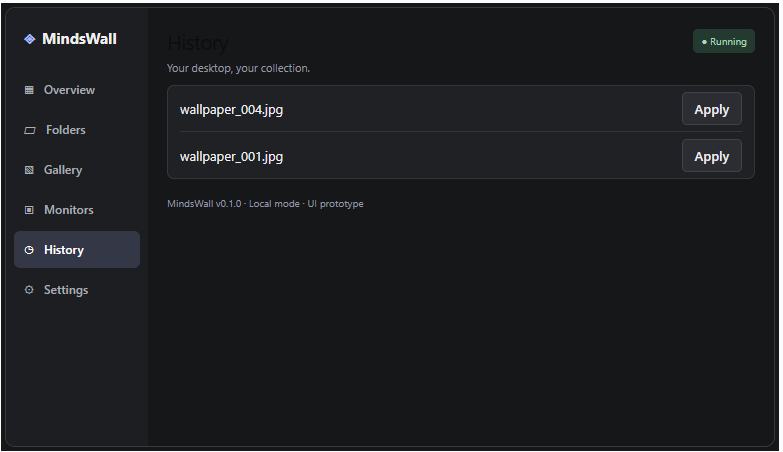
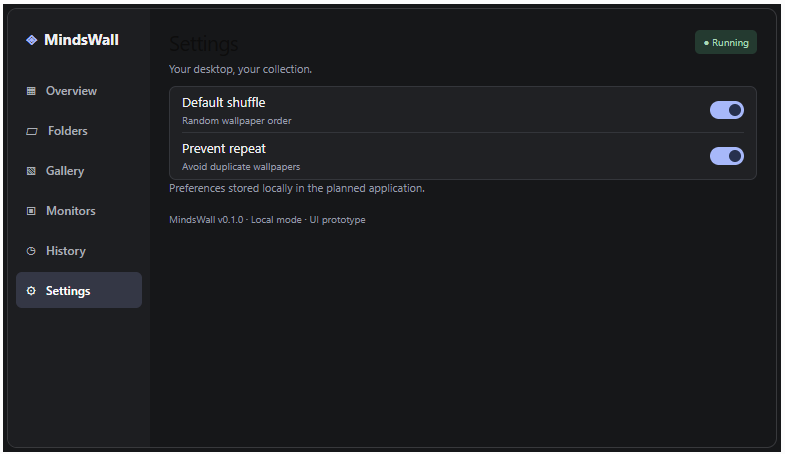

# Project: MindsWall

_Lightweight Wallpaper Manager for Windows._

| หัวข้อ           | เป้าหมาย                 |
| ---------------- | ------------------------ |
| Platform         | Windows 11               |
| Language         | Rust                     |
| Application Type | Desktop Utility          |
| Architecture     | Local-first              |
| Distribution     | Portable EXE / Installer |
| License          | MIT (แนะนำ)              |
| Administrator    | ไม่จำเป็น                |
| Internet         | ไม่จำเป็น                |

## Feature Scope

| Module             | ความสามารถ                      | Priority |
| ------------------ | ------------------------------- | -------- |
| Wallpaper Engine   | เปลี่ยน Desktop Wallpaper       | P1       |
| Folder Management  | รองรับหลาย Folders              | P1       |
| Recursive Scanner  | ค้นหารูปใน Subfolders           | P1       |
| Slideshow          | เปลี่ยน Wallpaper ตามเวลา       | P1       |
| Shuffle Engine     | สุ่มรูปแบบไม่ซ้ำจนกว่าจะครบ     | P1       |
| System Tray        | ควบคุมโปรแกรมจาก Taskbar        | P1       |
| Configuration      | บันทึกการตั้งค่า                | P1       |
| Startup            | เปิดอัตโนมัติพร้อม Windows      | P2       |
| Multi-monitor      | ตั้ง Wallpaper แยกแต่ละจอ       | P2       |
| Image Filtering    | กรอง Resolution / Aspect Ratio  | P2       |
| Folder Watcher     | ตรวจจับรูปที่เพิ่มหรือลบ        | P2       |
| Wallpaper History  | ประวัติภาพที่เคยแสดง            | P2       |
| Wallpaper Gallery  | ดูตัวอย่างและเลือกรูป           | P2       |
| Wallpaper Profiles | สลับชุด Wallpaper               | P3       |
| Image Editor       | Crop / Resize / Blur / Dim      | P3       |
| Global Hotkeys     | เปลี่ยน Wallpaper ด้วย Shortcut | P3       |
| Import / Export    | สำรองการตั้งค่า                 | P3       |

## Technology Stack

| Technology     | Tauri 2            |
| -------------- | ------------------ |
| Backend        | Rust               |
| Frontend       | React + TypeScript |
| ความยาก        | ปานกลาง            |
| การออกแบบ UI   | ยืดหยุ่นมาก        |
| การใช้ทรัพยากร | ขึ้นกับ WebView    |

**Tauri 2 + Rust + React**

### Libraries / Crates

| Library                                                                   | หน้าที่                 |
| ------------------------------------------------------------------------- | ----------------------- |
| [windows](https://github.com/microsoft/windows-rs?utm_source=chatgpt.com) | เรียก Windows API       |
| [walkdir](https://crates.io/crates/walkdir?utm_source=chatgpt.com)        | ค้นหาไฟล์ใน Subfolders  |
| [rand](https://crates.io/crates/rand?utm_source=chatgpt.com)              | Random และ Shuffle      |
| [serde](https://crates.io/crates/serde?utm_source=chatgpt.com)            | Serialize / Deserialize |
| [serde_json](https://crates.io/crates/serde_json?utm_source=chatgpt.com)  | JSON Configuration      |
| [image](https://crates.io/crates/image?utm_source=chatgpt.com)            | Image Processing        |
| [notify](https://crates.io/crates/notify?utm_source=chatgpt.com)          | File System Watcher     |
| [tracing](https://crates.io/crates/tracing?utm_source=chatgpt.com)        | Application Logging     |
| [thiserror](https://crates.io/crates/thiserror?utm_source=chatgpt.com)    | Error Handling          |
| [clap](https://crates.io/crates/clap?utm_source=chatgpt.com)              | CLI Commands            |
| [tauri](https://v2.tauri.app/?utm_source=chatgpt.com)                     | Desktop Application     |
| [shadcn/ui](https://ui.shadcn.com/?utm_source=chatgpt.com)                | UI Components           |

## Application Architecture

## UI Concept

prototype

## Development Roadmap

**Phase 0 — Rust Fundamentals**

[ ] ติดตั้ง Rust และ Cargo

[ ] Ownership / Borrowing / References

[ ] Struct / Enum / Trait

[ ] Result / Option / Error Handling

[ ] Modules / Crates / File System

**Phase 1 — Wallpaper Core**

[ ] เปลี่ยน Wallpaper จาก File Path

[ ] Scan Folder และ Subfolders

[ ] รองรับ JPG, JPEG, PNG, BMP

[ ] Random Wallpaper

[ ] สร้าง CLI Commands

**Phase 2 — Slideshow Engine**

[ ] Multiple Folders

[ ] Shuffle Queue

[ ] Timer / Scheduler

[ ] JSON Configuration

[ ] Pause / Resume / Next / Previous

**Phase 3 — Desktop App**

[ ] Tauri + React Setup

[ ] Overview Dashboard

[ ] Folder Management

[ ] System Tray

[ ] Start with Windows

**Phase 4 — Wallpaper Utilities**

[ ] Multi-monitor Support

[ ] Image Gallery

[ ] Folder Watcher

[ ] Resolution Filtering

[ ] Wallpaper History

**Phase 5 — Release & Optimization**

[ ] Memory / CPU Benchmark

[ ] Unit Tests

[ ] Error Recovery

[ ] Portable EXE / Installer

[ ] GitHub Actions / Release

## Project Structure

mindswall/
├── src/
│ ├── main.rs
│ ├── lib.rs
│ ├── config.rs
│ ├── scanner.rs
│ ├── shuffle.rs
│ ├── scheduler.rs
│ └── wallpaper/
│ ├── mod.rs
│ └── windows.rs
├── tests/
├── assets/
├── Cargo.toml
├── Cargo.lock
├── config.example.json
├── .gitignore
├── README.md
├── AGENTS.md
└── LICENSE

## Performance Target

Idle CPU -> ต่ำกว่า 0.1% โดยเฉลี่ย

Background Core RAM -> ต่ำกว่า 30 MB

Network Usage -> 0
